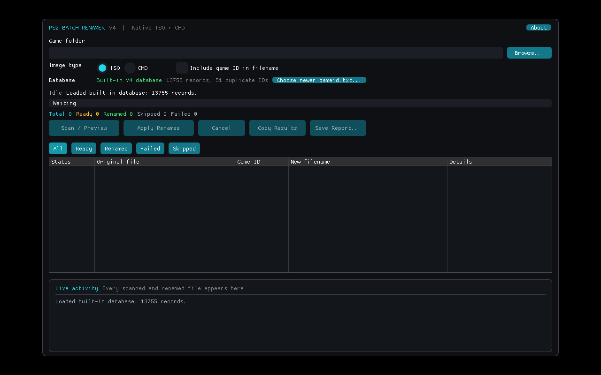

# PS2 Batch Renamer V4.1

A native desktop batch renamer for PlayStation 2 ISO and CHD images by
VajskiDs. V4 combines the V3 renamer and the former `GameName (game-id)` build
into one Dear ImGui application for Windows and Linux.

V4.1 is the definitive current release, replacing the earlier Windows-only
variants. It uses the repository's current online database by default and
keeps a complete audited copy inside the application for offline use.



## What changed in V4.1

- At startup, the app checks the canonical online `gameid.txt` in the
  background. A downloaded database is accepted only if it parses completely,
  contains at least 10,000 unique records, and is no larger than 4 MiB.
- If the computer is offline, GitHub is unavailable, or validation fails, the
  app continues with its built-in database. The downloaded text never replaces
  the repository file or writes a cache to the user's machine.
- The database was compared against current GameDB-PS2, GDX, PCSX2, and
  Get_CONFIG snapshots. The built-in result has 13,442 unique canonical IDs,
  no duplicate IDs, and no Windows-forbidden filename characters.
- Reviewed fixes include the three AFL serials, **Looney Tunes - Space Race**,
  the cancelled Japanese **Wacky Races**, both corrected Konami rhythm-game
  serials, **FIFA 06**, and the **Steamboy** trial disc.
- Unofficial English translations receive an `[English Translation]` suffix
  only when a documented patch changes the executable ID. The retail record is
  kept separately and remains unsuffixed.

## V4 application highlights

- One self-contained Windows executable with an embedded application icon; no
  .NET, console window, extraction, batch files, or helper executables.
- Native Linux application; Wine is not required.
- ISO and CHD files are read directly in-process. CHDs are not expanded into
  temporary ISO/CUE files.
- The audited `gameid.txt` is compiled into the application. Use **Refresh
  online**, select a local/custom file, or restore the built-in copy with one
  click.
- Optional **Include game ID in filename** mode produces
  `Game Title (SLUS_123.45).iso` or `.chd`. With the option off, V3-style
  `Game Title.iso` / `.chd` names are used.
- Scan/preview and rename are separate steps. Nothing is overwritten.
- Every file appears in a live results table and activity view while work is
  running. Failed items produce a persistent red warning, a review prompt,
  and a one-click failed-items filter.
- `failed.txt` and `PS2_iso_files.txt` are no longer written into the games
  folder. Copying results or saving a report is optional.

## Using it

1. Download the Windows `.exe` or Linux `.AppImage` from
   [Releases](https://github.com/L10N37/PS2-ISO-Batch-Renamer-/releases).
2. Select or drag in the folder containing the games.
3. Select **ISO** or **CHD**, and optionally tick **Include game ID in
   filename**.
4. Check the database status. The app normally reports **Online database
   (GitHub)**; without internet it identifies the built-in fallback instead.
5. Choose **Scan / Preview**. Review the proposed names and any failures in
   the application window.
6. Choose **Apply Renames**.

The scan is non-recursive: only images directly inside the selected folder are
processed. A destination that already exists is reported as failed and is
never replaced.

On Linux, make the downloaded AppImage executable before opening it:

```bash
chmod +x PS2-Batch-Renamer-V4-Linux-x86_64.AppImage
```

## Database

The root [`gameid.txt`](gameid.txt) is the database embedded in a V4 build.
V4.1 contains 13,442 records with 13,442 unique IDs and no duplicate built-in
entries. The app checks the canonical
[`main/gameid.txt`](https://raw.githubusercontent.com/L10N37/PS2-ISO-Batch-Renamer-/main/gameid.txt)
at startup and falls back to that embedded copy without blocking scanning.
Select **Choose local gameid.txt...** to use a custom database for the current
session. Local databases preserve their order and the established
first-match-wins behavior if they contain duplicate IDs.

V4.1 decodes the old batch-file escape `^!` as `!` and removes trailing
line-padding whitespace, so those database storage artifacts never appear in
generated filenames. The built-in database includes the documented unofficial
Usagiru `USGR` compilation IDs; these remain clearly recorded as community
releases.

Each non-empty database line must contain an 11-character game ID, one space,
then the title:

```text
SLUS_217.20 Arcana Heart
```

The new audit is intentionally reviewable rather than pretending every one of
13,000+ names can be trusted automatically:

- [`docs/database-audit-v4.1.0.md`](docs/database-audit-v4.1.0.md) explains the
  source counts and conservative decision rules.
- [`docs/database-changes-v4.1.0.tsv`](docs/database-changes-v4.1.0.tsv) records
  every automatic addition, removal, and correction.
- [`docs/database-review-v4.1.0.tsv`](docs/database-review-v4.1.0.tsv) is the
  remaining manual review queue.
- [`tools/reviewed_titles.tsv`](tools/reviewed_titles.tsv) and
  [`tools/verified_translations.tsv`](tools/verified_translations.tsv) hold
  decisions that must survive future database rebuilds.

For the next database release, download fresh copies of all four reference
catalogues and generate a new versioned audit (example version shown):

```bash
tools/update_database.sh 4.2.0
```

Review the resulting diff and queue before committing. The script changes only
local files; it does not push anything, and it refuses to overwrite an existing
version's reports. `--base-ref GIT_REF` can reproduce a historical audit from
that revision's `gameid.txt`; replacing an existing report additionally requires
the explicit `--replace-reports` safeguard.

## Identification method

The proven handwritten identification method from the earlier releases is
preserved: V4 reads the root-directory sector stored at `0x80A4`, searches the
2,048-byte root directory for `EM.CNF`, follows the original extent bytes to
`SYSTEM.CNF`, finds `0:\`, and reads the following 11-byte game ID. The same
logic is used for ISO and for the cooked disc data exposed by a CHD.

See [`docs/algorithm.md`](docs/algorithm.md) for the parity notes and regression
test coverage.

## Building

V4 uses CMake 3.24+, C++20, Dear ImGui, SDL3, libchdr, and libcurl on Linux.
The source dependencies are pinned and fetched by CMake. On Fedora, install the
compiler/build tools plus the normal X11/OpenGL/audio and curl development
packages first; at minimum the command names `cmake`, `ctest`, `git`, and
`ninja` must be available.

```bash
cmake -S . -B build -DPS2BR_BUILD_TESTS=ON
cmake --build build --config Release
ctest --test-dir build -C Release --output-on-failure
```

Linux builds need the normal X11/OpenGL development packages. The GitHub
Actions workflow is the reference build environment for both release targets.

## Releasing from Fedora (including Windows)

You do not need to boot Windows. After the audited branch has been reviewed,
committed, and merged into a clean local `main`, run the non-publishing check:

```bash
tools/release_from_fedora.sh 4.1.0
```

When that succeeds, explicitly publish:

```bash
tools/release_from_fedora.sh --publish 4.1.0
```

The second command pushes `main` and a new annotated `v4.1.0` tag. The tag
triggers GitHub Actions, which builds and tests the Windows x64 executable and
Linux x86_64 AppImage, calculates checksums, and publishes both plus the audited
standalone `gameid.txt` using
[`RELEASE_NOTES_V4.md`](RELEASE_NOTES_V4.md). The script refuses a dirty tree,
the wrong branch, a diverged `main`, a version mismatch, or an existing tag.

## Legacy versions

The earlier Windows-only tools and their original source are retained under
[`legacy/`](legacy/) for project history. V4 does not execute or bundle those
programs.

## License

PS2 Batch Renamer is distributed under the
[GNU General Public License v3.0](LICENSE.txt). Dependency notices are embedded
in the app's **About** window and are also available in
[`THIRD_PARTY_NOTICES.md`](THIRD_PARTY_NOTICES.md).
